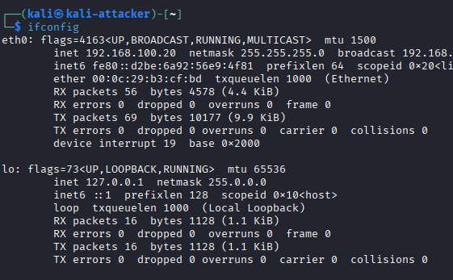
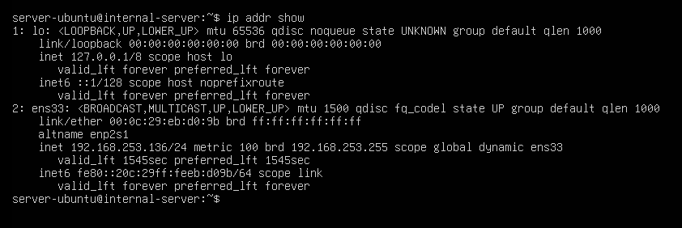
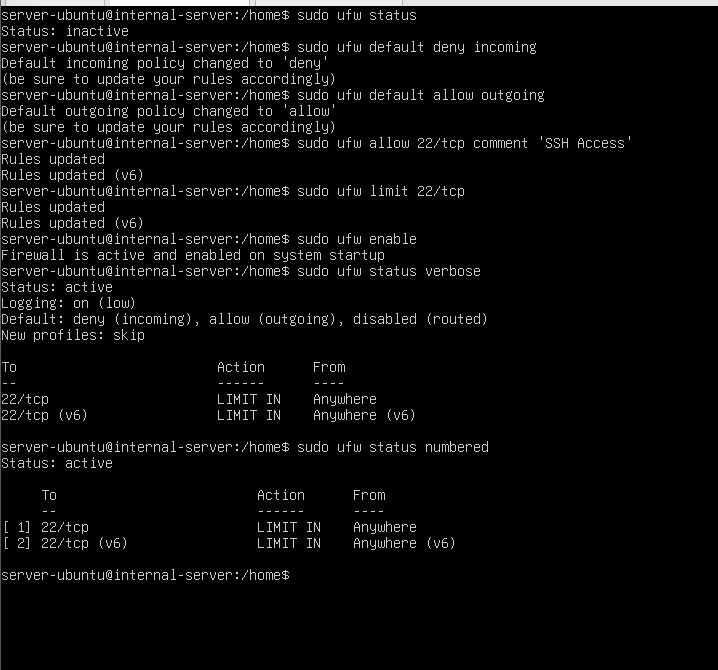
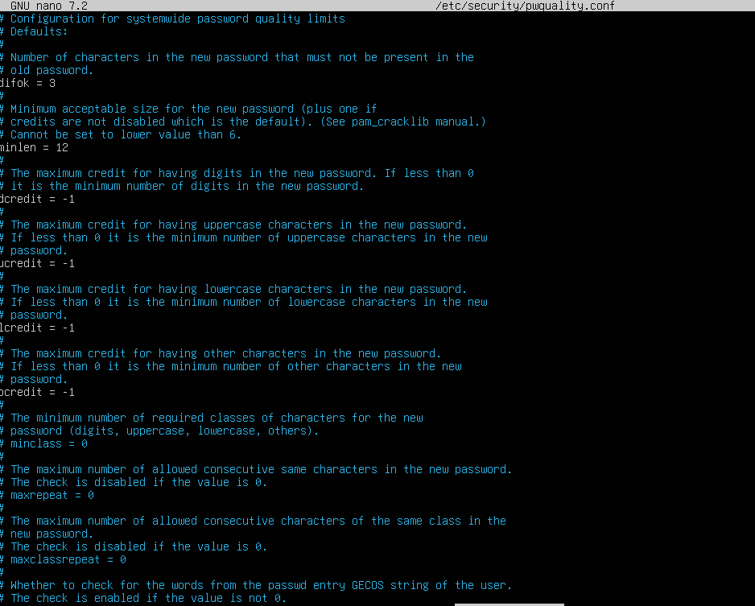
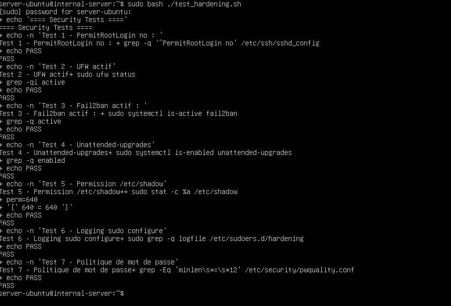
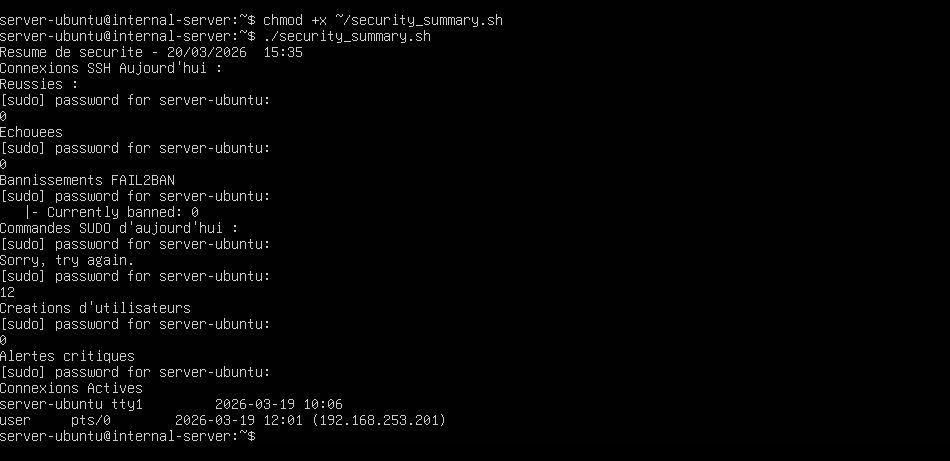
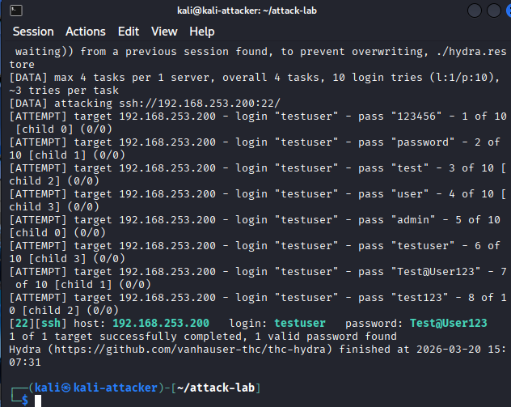
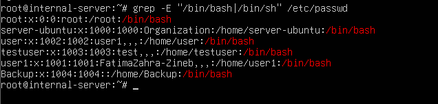
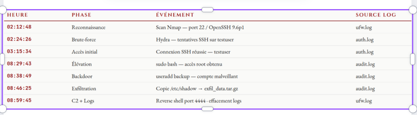

# Simulation d'une attaque SSH et analyse forensique des journaux sur un serveur Linux durci à l'aide d'auditd

Projet du module **Administration sécurisée et forensique** (filière Intelligence Artificielle et Cybersécurité, ENSA Béni Mellal, année 2025-2026).

Le projet déroule un cycle complet de sécurité opérationnelle sur deux machines virtuelles (**Kali Linux** et **Ubuntu Server**) : durcissement du serveur, journalisation avec **auditd**, simulation d'une attaque SSH en 7 phases, analyse forensique des traces, puis réponse à incident.

- **Réalisé par** : Khaoula Ettijani, Fatima Ezzahra Nait Hammou, Zineb Lakhmaiss
- **Encadré par** : Pr. Hamza Touil
- **Soutenu le** : 31 mars 2026

> **Avertissement.** Tout ce qui est décrit ici a été réalisé dans un laboratoire isolé, sur des machines virtuelles appartenant aux auteures, à des fins pédagogiques. Les comptes et mots de passe affichés (`testuser`, `Test@User123`...) sont fictifs et volontairement faibles. N'utilisez jamais ces techniques contre un système sans autorisation écrite de son propriétaire.

## Contenu du dépôt

| Dossier | Contenu |
|---|---|
| [`docs/Rapport_projet_ASF.pdf`](docs/Rapport_projet_ASF.pdf) | Rapport complet (34 pages) : modèle de menace, hardening, journalisation, attaque, forensique, réponse à incident |
| [`docs/Rapport_investigation_forensique.pdf`](docs/Rapport_investigation_forensique.pdf) | Rapport d'investigation forensique (4 pages) |
| [`images/`](images) | Les 25 captures d'écran du laboratoire, numérotées dans l'ordre du projet |

## Laboratoire

Réseau interne isolé `192.168.253.0/24` sous VMware, sans accès à Internet : l'attaque reste confinée.

| Machine | Rôle | Système | Adresse |
|---|---|---|---|
| `internal-server` | Cible | Ubuntu Server 24.04 LTS (OpenSSH 9.6p1) | 192.168.253.200 |
| `kali-attacker` | Attaquant | Kali Linux (Nmap 7.95, Hydra 9.5, Netcat) | 192.168.253.201 |

| Kali | Ubuntu |
|---|---|
|  |  |

## 1. Modèle de menace

Les actifs critiques sont les comptes privilégiés, le service SSH (port 22) et les fichiers `/etc/passwd`, `/etc/shadow` et `/etc/sudoers`. La configuration initiale volontairement faible exposait : connexion root autorisée, authentification par mot de passe sans protection anti-force brute, aucun pare-feu, sudo permissif, aucun audit des commandes privilégiées.

## 2. Hardening du serveur

Avant toute modification, les fichiers de configuration (`sshd_config`, `sudoers`, `passwd`, `shadow`) ont été sauvegardés dans `~/backup_config`.

| Domaine | Mesure appliquée |
|---|---|
| **SSH** | `PermitRootLogin no`, `MaxAuthTries 3`, `LoginGraceTime 60`, `LogLevel VERBOSE`, clé ED25519 pour le compte `user` |
| **Fail2Ban** | Bannissement après 3 échecs, durée 3600 s, fenêtre de détection 600 s |
| **Pare-feu UFW** | Entrant refusé par défaut, `ufw limit 22/tcp`, journalisation activée |
| **Mots de passe** | `libpam-pwquality` (12 caractères minimum, 4 classes de caractères, dictionnaire), expiration à 90 jours |
| **Sudo** | `/etc/sudoers.d/hardening` : journal dans `/var/log/sudo.log`, `timestamp_timeout=0`, commandes dangereuses interdites |
| **Mises à jour** | `unattended-upgrades` pour les correctifs de sécurité |

Un script de validation `test_hardening.sh` confirme **7 tests sur 7** (root refusé, UFW actif, Fail2Ban actif, mises à jour, permissions de `/etc/shadow`, journal sudo, politique de mots de passe).

| Pare-feu UFW | Politique de mots de passe | Tests de validation |
|---|---|---|
|  |  |  |

## 3. Journalisation avec auditd

- **Rsyslog** : fichiers spécialisés (`sshd.log`, `sudo.log`, `alerts.log`, `cron.log`, `ufw.log`), rotation sur 90 jours.
- **auditd** : plus de 50 règles dans `/etc/audit/rules.d/custom.rules`, avec des étiquettes (`passwd_changes`, `shadow_changes`, `sudoers_changes`, `user_creation`, `sudo_commands`...) sur les fichiers sensibles, les commandes privilégiées, le réseau, les modules noyau, cron et `/tmp`.
- Les règles sont rendues **immuables** (`-e 2`) : elles ne peuvent plus être modifiées sans redémarrage, ce qui empêche un attaquant de les désactiver.
- **NTP** : synchronisation sur des serveurs marocains et fuseau `Africa/Casablanca`, pour corréler correctement les événements.

## 4. Simulation de l'attaque (Cyber Kill Chain, 7 phases)

| # | Phase | Ce qui a été fait | Capture |
|---|---|---|---|
| 1 | Reconnaissance | Scan Nmap : port 22/tcp ouvert, méthodes `password` et `publickey` | [13](images/13-attaque-reconnaissance-nmap.png), [14](images/14-attaque-nmap-methodes-authentification.png), [15](images/15-attaque-banner-netcat.png) |
| 2 | Force brute SSH | Hydra avec une liste de mots de passe courants : mot de passe de `testuser` trouvé. Fail2Ban a détecté et banni l'IP | [16](images/16-attaque-bruteforce-hydra.png) |
| 3 | Accès initial | Connexion SSH avec le compte compromis, puis reconnaissance interne | [17](images/17-attaque-acces-initial-testuser.png) |
| 4 | Élévation de privilèges | Règle sudo permissive `NOPASSWD: /bin/bash` : `sudo /bin/bash` donne un shell root | [18](images/18-attaque-elevation-privileges.png) |
| 5 | Persistance | Création d'un compte `Backup` avec droits sudo et clé SSH dans `authorized_keys` | [19](images/19-attaque-creation-compte-backdoor.png), [20](images/20-attaque-persistance-cle-ssh.png) |
| 6 | Exfiltration et C2 | Copie de `/etc/shadow`, `/etc/passwd`, `/etc/sudoers` dans une archive ; reverse shell vers le port 4444 | [21](images/21-attaque-exfiltration.png), [22](images/22-attaque-reverse-shell-port-4444.png) |
| 7 | Effacement des traces | Tentatives de vidage d'`auth.log`, de l'historique bash, de `wtmp` et `btmp` | [23](images/23-attaque-effacement-logs.png) |

## 5. Analyse forensique

Méthode en cinq étapes : préservation (processus, connexions, `/tmp`), acquisition avec empreintes **SHA-256**, analyse croisée des journaux, reconstitution de la chronologie, documentation.

Sources analysées : `auth.log`, `audit.log`, `sudo.log`, `fail2ban.log`, `ufw.log`.

Ce que montrent les journaux :

- **`auth.log`** : 13 échecs de connexion (10 sur `admin`, 3 sur `testuser`), puis `Accepted password for testuser` et l'ouverture de session. Fail2Ban a banni l'IP après 3 échecs.
- **auditd** : l'événement de sudo enregistre `uid=1002` (testuser) et `euid=0` (root). Le champ **`auid`**, qui ne change pas au cours de la session, désigne formellement `testuser` comme l'auteur de l'élévation et de la création du compte `Backup` (événement `ADD_USER`).
- **Accès aux fichiers sensibles** : chaque lecture de `/etc/shadow`, `/etc/passwd` et `/etc/sudoers` est horodatée.
- **Effacement des logs** : les tentatives de modification de `auth.log`, `wtmp` et `btmp` sont elles-mêmes enregistrées par auditd. Elles deviennent des preuves supplémentaires.
- **Comptes** : le compte `Backup` (uid 1003/1004 selon les captures, groupe `sudo`) n'existait pas avant l'attaque.

| Compte backdoor dans `/etc/passwd` | Chronologie reconstituée |
|---|---|
|  |  |

### Indicateurs de compromission (IOC)

| Type | Valeur | Contexte |
|---|---|---|
| IP attaquante | 192.168.253.201 | Source du brute-force SSH |
| IP cible | 192.168.253.200 | Serveur interne compromis |
| Compte compromis | `testuser` | Mot de passe faible trouvé par Hydra |
| Compte backdoor | `Backup` | Créé via `useradd`, avec clé SSH |
| Fichier exfiltré | `/tmp/exfil_data.tar.gz` | Contient `/etc/shadow` |
| Port C2 | 4444/tcp | Reverse shell sortant |
| Outils | Hydra 9.5, Nmap 7.95 | Reconnaissance et brute-force |

## 6. Réponse à incident (NIST SP 800-61)

1. **Confinement** : blocage de l'IP attaquante dans UFW, arrêt du processus du reverse shell, verrouillage du compte `Backup` (`passwd -l`, shell `nologin`), révocation des sessions de `testuser`.
2. **Éradication** : suppression du compte backdoor (`userdel -r`), des 8 fichiers malveillants de `/tmp`, des clés SSH illégitimes et de la règle sudo permissive (`/etc/sudoers.d/testuser_temp`).
3. **Récupération** : tous les mots de passe changés par précaution puisque `/etc/shadow` a été exfiltré, rotation des logs, journaux auditd conservés intacts comme source de preuves.
4. **Vérification de l'absence de persistance** : crontabs, services systemd, fichiers de démarrage (`.bashrc`...), binaires SUID récents et ports en écoute (seul le 22 reste ouvert).
5. **Durcissement post-incident** : Fail2Ban à 2 tentatives et 24 h de bannissement, `AllowUsers`, `MaxAuthTries 2`, redirections TCP et X11 désactivées, script de surveillance `security_monitor.sh` planifié toutes les heures.
6. **Tests finaux** : root refusé, brute-force bloqué par Fail2Ban, IP attaquante bloquée par UFW, compte `Backup` supprimé, plus de privilèges sudo pour `testuser`, plus de connexion sur le port 4444. Surveillance renforcée pendant 48 heures.

## 7. Recommandations

- **Court terme** : maintenir la surveillance, supprimer `testuser` s'il est inutile, auditer les autres systèmes pour des mots de passe ou des règles sudo semblables.
- **Moyen terme** : authentification à deux facteurs pour SSH, SIEM (Wazuh, ELK), sauvegardes externalisées, mots de passe de 14 caractères avec vérification contre les bases compromises.
- **Long terme** : segmentation réseau et Zero Trust, IDS/IPS (Suricata, Snort), tests d'intrusion réguliers, plan de réponse à incident formalisé.
- **SSH** : désactiver l'authentification par mot de passe et n'accepter que les clés, derrière un VPN si possible.
- **Logs** : les envoyer vers un serveur syslog distant, hors de portée de l'attaquant.

## Outils

Kali Linux · Ubuntu Server · VMware · OpenSSH · Nmap · Hydra · Netcat · auditd · rsyslog · Fail2Ban · UFW · libpam-pwquality · unattended-upgrades
